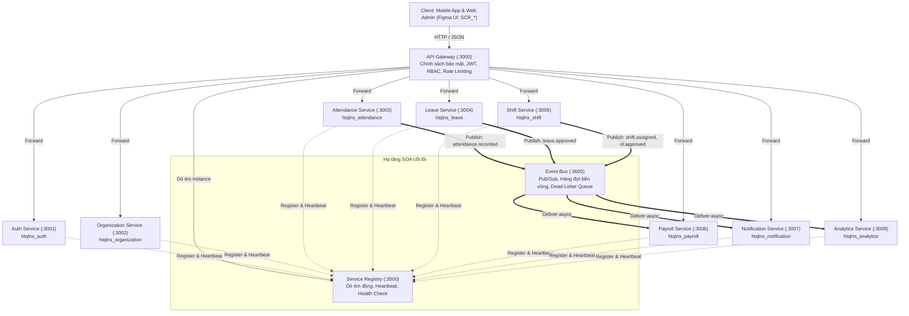

# Hệ thống Quản lý Chấm công - Tính lương & Nhân sự (HTQLNS)
## Kiến trúc Hướng Dịch Vụ (SOA) với Express.js

Dự án được tái cấu trúc hoàn toàn từ đầu dựa trên thiết kế Wireframe Figma **[Hiếu quản lý chấm công](https://www.figma.com/design/NI0ZSPFu6EjqwNWJ2LHYOK/Hi%E1%BA%BFu-qu%E1%BA%A3n-l%C3%BD-ch%E1%BA%A5m-c%C3%B4ng--Community-?node-id=0-1&p=f&t=8pk1kUpBKhhiC04j-0)**, tuân thủ các nguyên lý cốt lõi của **Kiến trúc Hướng Dịch Vụ (SOA)** và quy trình làm việc chuyên nghiệp (Agile/Scrum, Git workflow).

---

## 1. Kiến trúc Tổng thể Hệ thống



---

## 2. Bản đồ Ánh xạ Phân hệ Nghiệp vụ (Figma ↔ Microservices)

Toàn bộ 6 Epic, 25 màn hình và 24 bảng CSDL trong thiết kế được phân rã thành 8 Microservices tự trị:

| STT | Tên Microservice | Cổng | Cơ sở dữ liệu riêng | Epic ánh xạ (Figma) | Màn hình liên quan (SCR_*) |
| :---: | :--- | :---: | :--- | :--- | :--- |
| 1 | **auth-service** | `:3001` | `htqlns_auth` | **Epic 6**: Quản trị tài khoản, OTP, Sinh trắc học, Cấp phát JWT token | `SCR_AUTH_01`, `SCR_AUTH_02`, `SCR_USER_01` |
| 2 | **organization-service** | `:3002` | `htqlns_organization` | **Epic 6**: Phòng ban, nhân sự, chức danh, phân quyền RBAC & Nhật ký hệ thống | `SCR_ADM_05`, `SCR_ADM_06`, `SCR_USER_01` |
| 3 | **attendance-service** | `:3003` | `htqlns_attendance` | **Epic 2**: Chấm công (GPS/WiFi/FaceID), kiểm tra đi muộn/về sớm, giải trình công | `SCR_ATT_01`, `SCR_ATT_02`, `SCR_ATT_03`, `SCR_ATT_04`, `SCR_ADM_02` |
| 4 | **leave-service** | `:3004` | `htqlns_leave` | **Epic 1**: Cấu hình loại nghỉ phép, quản lý quỹ phép năm, tạo & duyệt đơn xin nghỉ phép | `SCR_LEAVE_01`, `SCR_LEAVE_02`, `SCR_LEAVE_03`, `SCR_ADM_01`, `SCR_REQ_01` |
| 5 | **shift-service** | `:3005` | `htqlns_shift` | **Epic 3**: Danh mục ca làm việc, phân ca nhân viên, đăng ký & phê duyệt tăng ca (OT) / đổi ca | `SCR_SHIFT_01`, `SCR_OT_01`, `SCR_OT_02`, `SCR_ADM_03`, `SCR_REQ_01` |
| 6 | **payroll-service** | `:3006` | `htqlns_payroll` | **Epic 4**: Công thức lương, phụ cấp, BHXH/Thuế, chốt kỳ lương & xuất phiếu lương (Payslip) | `SCR_PAY_01`, `SCR_ADM_04`, `SCR_ADM_07` |
| 7 | **notification-service**| `:3007` | `htqlns_notification` | **Epic 5 & Xuyên suốt**: Push notification, cảnh báo giờ giấc, thông báo duyệt đơn, thông báo lương | `SCR_NOTIF_01` |
| 8 | **analytics-service** | `:3008` | `htqlns_analytics` | **Epic 5**: Dashboard chuyên cần, chỉ số năng suất, cảnh báo vượt ngưỡng vắng mặt/OT | `SCR_DASH_01`, `SCR_REP_01` |

---

## 3. Cấu trúc Thư mục Hệ thống trên Nhánh Chính (`main`)

```
HTQLNS-main/
├── config/
│   └── policies.json               # Cấu hình chính sách API Gateway (RBAC, Rate limit, Route mapping)
├── database/
│   ├── 01_auth_db.sql              # Schema dịch vụ xác thực & tài khoản
│   ├── 02_organization_db.sql      # Schema phòng ban, nhân viên, phân quyền RBAC
│   ├── 03_attendance_db.sql        # Schema vị trí GPS/WiFi, bản ghi chấm công, giải trình
│   ├── 04_leave_db.sql             # Schema loại nghỉ phép, quỹ phép, đơn xin nghỉ phép
│   ├── 05_shift_db.sql             # Schema danh mục ca, phân ca làm việc, đăng ký OT / đổi ca
│   ├── 06_payroll_db.sql           # Schema công thức lương, kỳ lương, phiếu lương Payslip
│   ├── 07_notification_db.sql      # Schema thông báo & cảnh báo
│   ├── 08_analytics_db.sql         # Schema quy tắc ngưỡng cảnh báo, chỉ số chuyên cần
│   └── init_all_databases.sql      # Script khởi tạo tổng hợp toàn bộ các CSDL
├── event-bus/
│   └── server.js                   # Event Bus Server (Pub/Sub bất đồng bộ, Durable Queue, DLQ)
├── gateway/
│   └── server.js                   # API Gateway (Điểm vào duy nhất, JWT, RBAC, Rate Limiting, Proxy)
├── registry/
│   └── server.js                   # Service Registry (Dò tìm động, Heartbeat, Health Sweep)
├── shared/
│   ├── client.js                   # Client gọi dịch vụ (Discovery, Load Balancing, Circuit Breaker)
│   ├── service-base.js             # Khung chuẩn cho Express Service (/health, OpenAPI, guard x-internal-key)
│   ├── registrar.js                # Module tự động đăng ký và gửi heartbeat lên Registry
│   ├── events.js                   # Helper publish / subscribe qua Event Bus
│   ├── db.js                       # Connection pool & auto migration cho từng database
│   ├── jwt.js                      # Ký và xác thực JWT token
│   ├── httpx.js                    # Các hàm tiện ích đọc body JSON, response, internal guard
│   ├── env.js                      # Quản lý nạp biến môi trường
│   ├── log.js                      # Logger đa tầng có gắn tên service
│   └── openapi.js                  # Tự động sinh tài liệu chuẩn OpenAPI 3.0
├── services/
│   ├── auth-service/index.js       # Express entrypoint Auth Service
│   ├── organization-service/index.js
│   ├── attendance-service/index.js
│   ├── leave-service/index.js
│   ├── shift-service/index.js
│   ├── payroll-service/index.js
│   ├── notification-service/index.js
│   └── analytics-service/index.js
├── public/
│   ├── css/style.css               # Giao diện web demo
│   ├── js/app.js                   # Client app tương tác với API Gateway
│   └── index.html                  # Giao diện chính
├── scripts/
│   ├── run-all.js                  # Script chạy đồng thời toàn bộ cụm hạ tầng & dịch vụ
│   └── seed.js                     # Script tạo dữ liệu mẫu kiểm thử
├── tests/
│   ├── infra.test.js               # Bộ kiểm thử hạ tầng SOA
│   └── e2e.test.js                 # Bộ kiểm thử tích hợp đầu cuối (E2E)
├── .dockerignore
├── .env.example
├── .gitignore
├── docker-compose.yml
├── Dockerfile
├── package.json
└── README.md
```

---

## 4. Quy ước Phân nhánh Git (Git Workflow Roadmap)

Theo yêu cầu môn học và chuẩn GitHub Flow, nhánh `main` này đóng vai trò là **nhánh chính** (khung kiến trúc và file scaffold). Các tính năng sẽ được phát triển trên các nhánh tiếp theo:

1. **`feature/infrastructure`**: Cấu hình chi tiết `shared/`, `registry/`, `event-bus/`, `gateway/`.
2. **`feature/auth-and-org`**: Cấu hình `auth-service` & `organization-service` (Bảng lõi, RBAC).
3. **`feature/attendance`**: Cấu hình `attendance-service` (Check-in/out, GPS/WiFi, giải trình).
4. **`feature/leave`**: Cấu hình `leave-service` (Quỹ phép, đơn xin nghỉ phép).
5. **`feature/shift-and-ot`**: Cấu hình `shift-service` (Phân ca, tăng ca OT).
6. **`feature/payroll`**: Cấu hình `payroll-service` (Tính lương tự động, phiếu lương Payslip).
7. **`feature/analytics-notif`**: Cấu hình `notification-service` & `analytics-service` (Dashboard).
8. **`feature/testing-e2e`**: Cấu hình `infra.test.js` & `e2e.test.js`.

> Dự án cũ (Hệ thống Quản lý Đồ án Tốt nghiệp) đã được sao lưu toàn vẹn trên nhánh `legacy-htqldt`.

## 5. Chạy hệ thống trên máy cá nhân

Hệ thống cần MySQL hoạt động trên cổng `3306`. Nếu cấu hình kết nối MySQL không đúng, Analytics Service sẽ trả `/health` với trạng thái `DOWN` và dashboard không tải được dữ liệu.

1. Tạo file cấu hình cục bộ từ mẫu:

   ```powershell
   Copy-Item .env.example .env
   ```

2. Sửa `.env`, điền đúng `DB_USER` và `DB_PASSWORD` theo tài khoản MySQL trên máy. Không gửi hoặc commit file `.env`.

   Nếu bạn muốn dùng MySQL qua Docker để khởi động nhanh, có thể chạy:

   ```powershell
   docker compose up -d mysql
   ```

3. Khởi tạo các database và bảng. Mở **Command Prompt** tại thư mục dự án:

   ```cmd
   cd database
   mysql -u root -p < init_all_databases.sql
   ```

   Nếu dùng tài khoản MySQL khác `root`, thay tên tài khoản trong lệnh trên.

4. Khởi động hệ thống từ thư mục gốc dự án:

   ```powershell
   npm start
   ```

5. Kiểm tra Analytics Service tại `http://localhost:3008/health`. Chỉ khi trường `status` là `UP` và `database` là `UP`, dashboard mới có thể lấy dữ liệu tổng hợp.

Chạy `npm test` để kiểm tra các luồng backend. Các bài kiểm tra kết nối database sẽ bị bỏ qua nếu MySQL chưa sẵn sàng.
