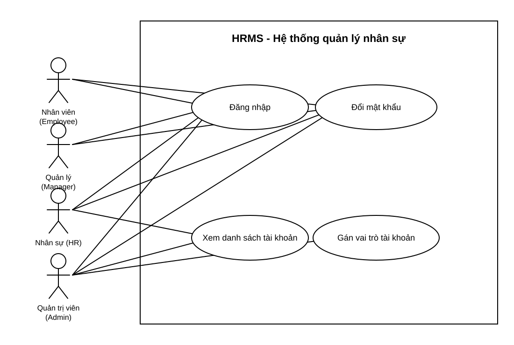
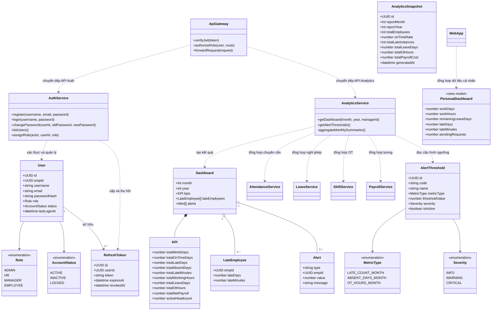
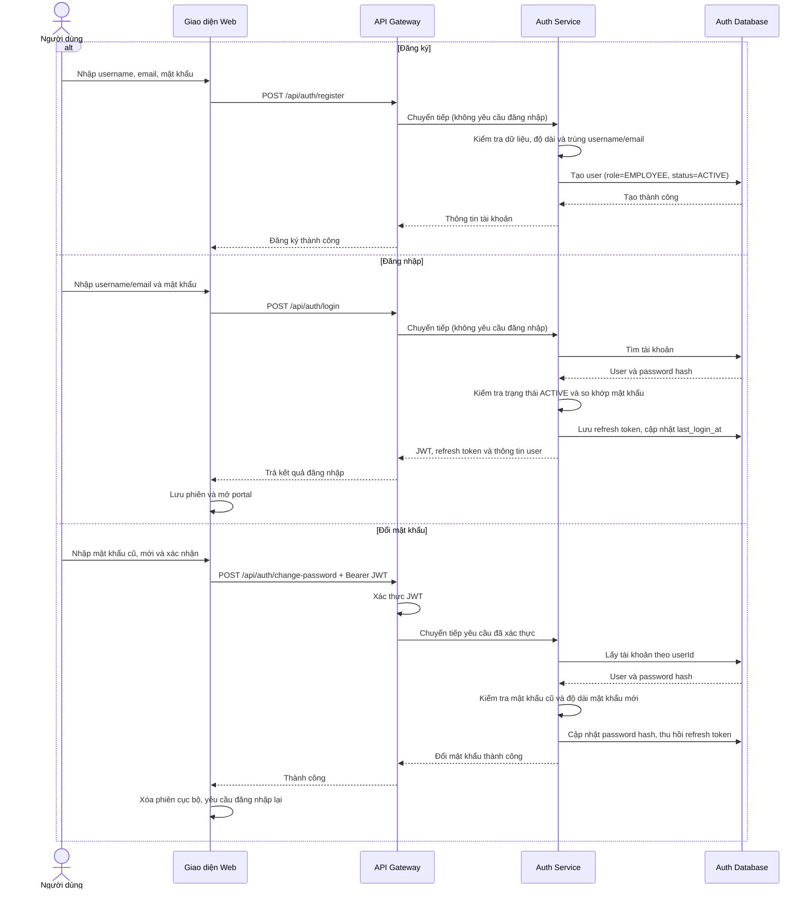
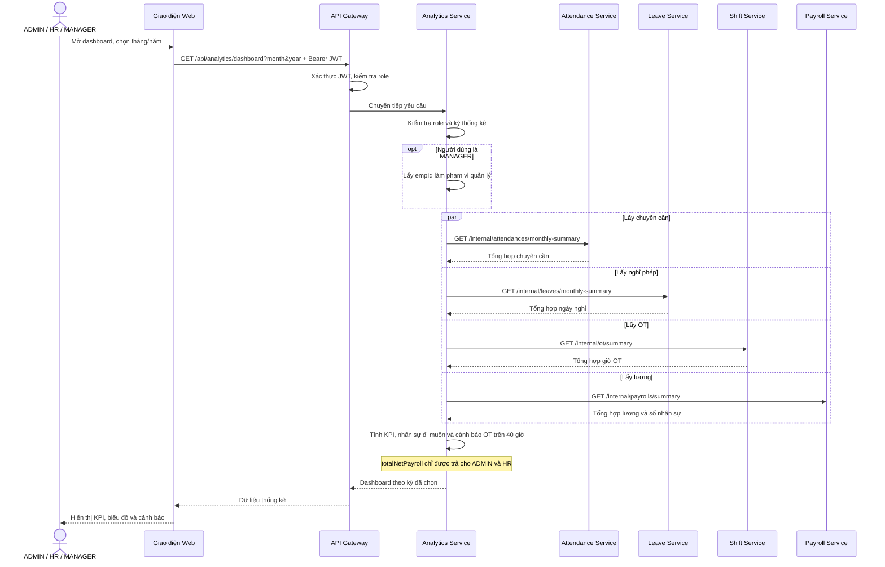
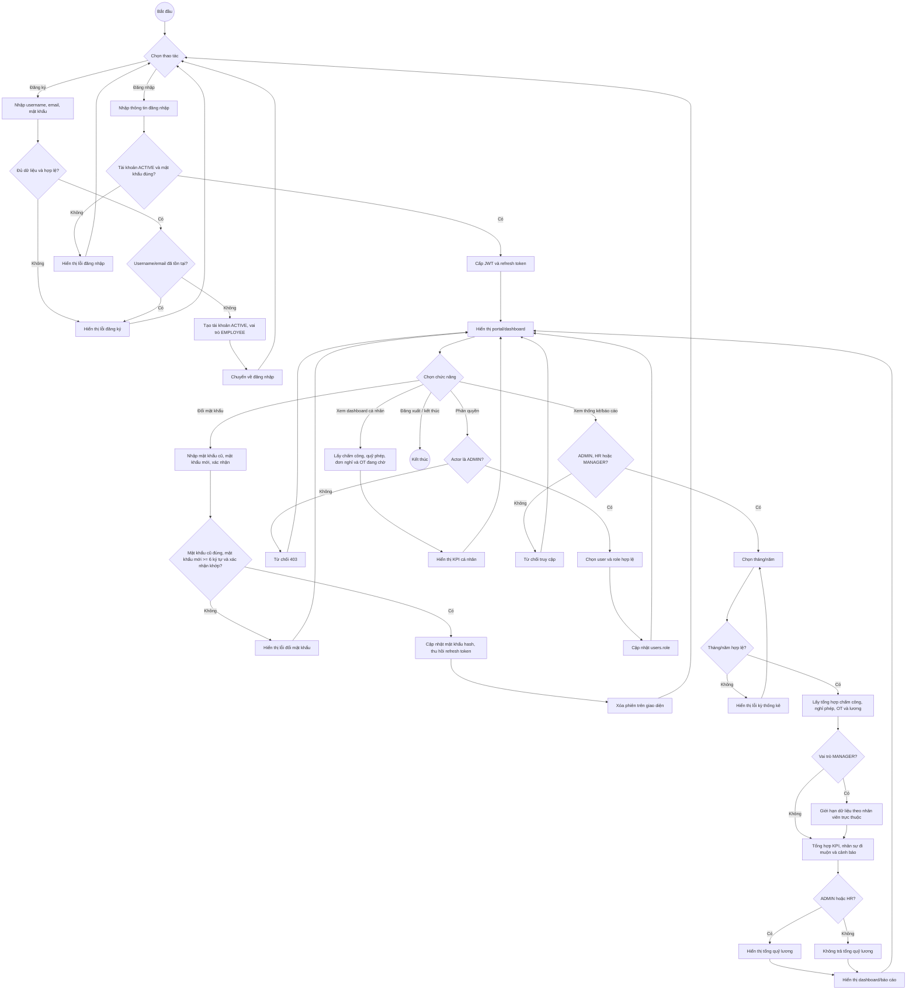

# Sơ đồ các chức năng được phân công

Phạm vi: đăng nhập, đăng ký, dashboard, đổi mật khẩu, phân quyền và thống kê/báo cáo.  
Các sơ đồ được đối chiếu với `auth-service`, `analytics-service`, API Gateway, giao diện web và schema CSDL hiện tại.

## 1. Use Case Diagram



Sơ đồ tập trung vào đăng nhập, đổi mật khẩu và phân quyền tài khoản. Nhân sự và Quản trị viên được xem danh sách tài khoản; chỉ Quản trị viên được gán vai trò.

## 2. Class Diagram



`AnalyticsSnapshot` có trong schema CSDL nhưng endpoint dashboard hiện tổng hợp dữ liệu trực tiếp từ các dịch vụ chấm công, nghỉ phép, OT và lương; chưa đọc/ghi snapshot.
`Dashboard.kpis.totalNetPayroll` có thể là `null` với vai trò `MANAGER`.

## 3. Sequence Diagram

### 3.1 Đăng ký, đăng nhập và đổi mật khẩu



### 3.2 Phân quyền tài khoản

```mermaid
sequenceDiagram
    actor Admin as ADMIN
    participant Web as Giao diện Web
    participant GW as API Gateway
    participant Auth as Auth Service
    participant DB as Auth Database

    Admin->>Web: Mở màn hình phân quyền
    Web->>GW: GET /api/auth/users + Bearer JWT
    GW->>GW: Xác thực JWT và kiểm tra route
    GW->>Auth: Chuyển tiếp yêu cầu
    Auth->>Auth: Kiểm tra quyền ADMIN hoặc HR
    Auth->>DB: Đọc danh sách tài khoản
    DB-->>Auth: Danh sách user và role
    Auth-->>Web: Danh sách tài khoản
    Admin->>Web: Chọn role mới và lưu
    Web->>GW: PUT /api/auth/users/{id}/role
    GW->>GW: Xác thực JWT; route cho ADMIN/HR
    GW->>Auth: Chuyển tiếp yêu cầu
    Auth->>Auth: Chỉ cho phép actor ADMIN, kiểm tra role hợp lệ
    alt Actor là ADMIN, role hợp lệ
        Auth->>DB: UPDATE users.role
        DB-->>Auth: Cập nhật thành công
        Auth-->>Web: Thành công
        Web->>Web: Hiển thị thông báo và tải lại danh sách
    else Không đủ quyền hoặc role không hợp lệ
        Auth-->>Web: Trả lỗi 403 hoặc 400
    end
```

### 3.3 Xem dashboard thống kê



## 4. Activity Diagram



## Nguồn đối chiếu trong dự án

- `services/auth-service/index.js`: đăng ký, đăng nhập, đổi mật khẩu, danh sách tài khoản và cập nhật vai trò.
- `services/analytics-service/index.js`: quyền truy cập dashboard/ngưỡng cảnh báo, tổng hợp KPI và các dịch vụ nguồn.
- `gateway/server.js` và `config/policies.json`: xác thực JWT, quyền theo route và chuyển tiếp API.
- `database/01_auth_db.sql` và `database/08_analytics_db.sql`: mô hình tài khoản, refresh token và schema analytics.
- `public/js/app.js` và `public/index.html`: các form/màn hình và hành vi giao diện tương ứng.
